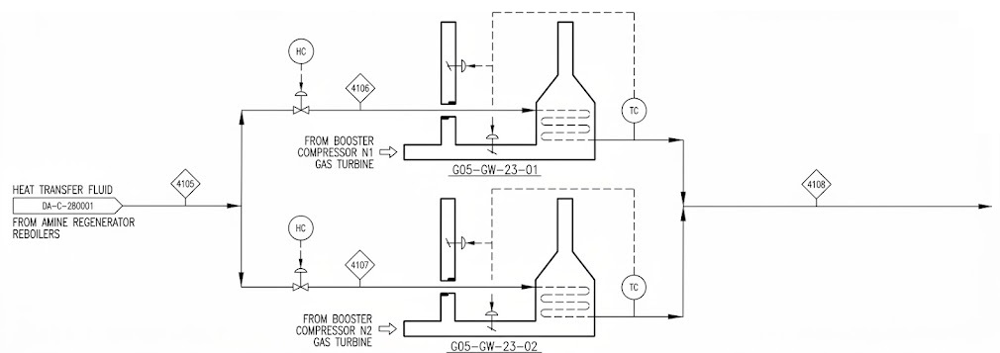
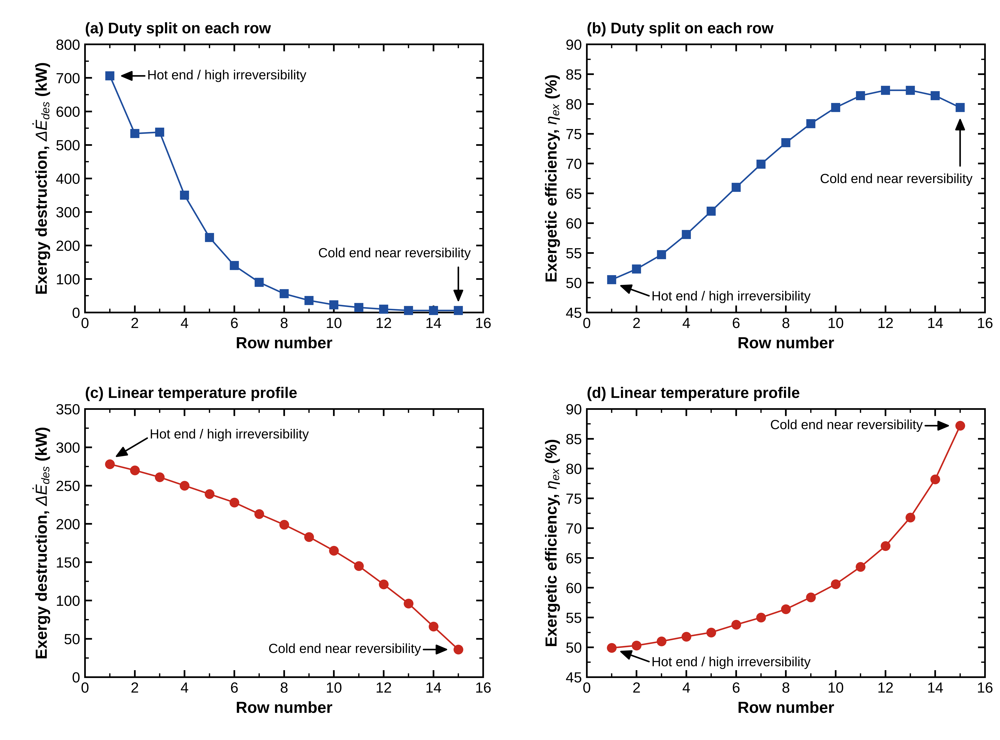
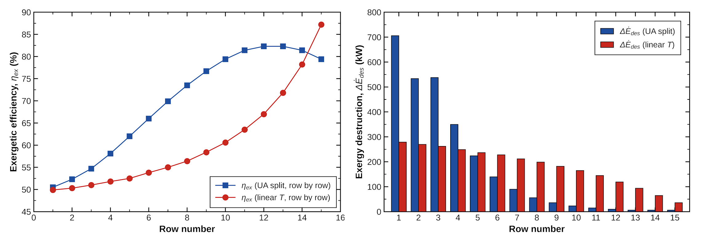

[English](README.md) | [Deutsch](README.de.md) | [Français](README.fr.md)

# Exergieanalyse der Gasturbinen-Abhitzerückgewinnungseinheiten (WHRU) G05-GW-23-01 und 02 an den Booster-Gasverdichtern (Excel), Rhourde-Nouss

**Zentrale Erdgasaufbereitungsanlage Rhourde-Nouss, Südosten Algeriens**

  
   
  <em>Abbildung 1: Abhitzerückgewinnungseinheiten G05-GW-23-01 und 02 an den Booster-Gasverdichtern, schematische Darstellung (nicht maßstäblich).</em>

## Übersicht
Exergieanalyse einer Doppelanlage aus zwei Abhitzerückgewinnungseinheiten (WHRU), die Wärme aus den Abgasen der Booster-Gasverdichterturbinen in einer zentralen Aufbereitungsanlage (Central Processing Facility, CPF) für die Erdgasbehandlung zurückgewinnen.

Der exergetische Gesamtwirkungsgrad einer Gasturbinen-WHRU wird aus den Exergien von Gas und Öl berechnet, die reihenweise über die 16 Reihen der Einheit ausgewertet werden. Zwei Konfigurationen des Temperaturprofils werden verglichen, um zu zeigen, wie die Modellannahme den Ort und das Ausmaß der Exergievernichtung verändert.

## Methode
- Exergien von Gas und Öl für jede der **16 Reihen** der WHRU berechnet.
- Zwei Konfigurationen verglichen:
  1. **Linearer Temperaturverlauf:** linearer Temperaturanstieg des Öls und linearer Temperaturabfall des Abgases zwischen Ein- und Austritt der Einheit.
  2. **UA-Aufteilung:** reihenspezifische UA-Werte, Temperaturen und Drücke.
- Exergievernichtung (ΔĖdestruc) und exergetischer Wirkungsgrad (ηex) je Reihe ausgewertet, zusammen mit dem kumulativen Anteil an der gesamten Exergievernichtung.

## Zentrale Ergebnisse
- **Exergetischer Gesamtwirkungsgrad:** ηex = 58,5 %, bei **2,75 MW** vernichteter Exergie.
- **Verteilung der Exergievernichtung:**

| Konfiguration | Anteil der Vernichtung in den ersten 3 Reihen | Erreichter kumulativer Anteil |
|---|---|---|
| UA-Aufteilung (reihenspezifisches UA) | 65 % | 90 % bis Reihe 6 |
| Linearer Temperaturverlauf | 29 % | 93 % bis Reihe 12 |

## Warum die UA-Aufteilung wichtig ist
Ein linearer Temperaturverlauf zwischen Ein- und Austritt beider Ströme erzwingt auf jeder Reihe ein konstantes UA von **850 kW/°C**. Das ist physikalisch nicht möglich, da sich das UA von Reihe zu Reihe ändert, während Wärme zwischen dem Abgas und dem in den Rohren strömenden Wärmeträgeröl übertragen wird. Die UA-Aufteilung (abklingendes UA) berücksichtigt diese Veränderung und zeigt, dass die Exergievernichtung auf die ersten Reihen der Einheit konzentriert ist, während das lineare Profil sie auf deutlich mehr Reihen verteilt.

## Abbildungen

  
   
  <em>Abbildung 2: Reihenweiser Vergleich der Profile (linearer Temperaturverlauf vs. UA-Aufteilung), des exergetischen Wirkungsgrads (ηex) und der Exergievernichtung (ΔĖdestruc).</em>

  
   
  <em>Abbildung 3: Kombinierter reihenweiser Vergleich der Profile (linearer Temperaturverlauf vs. UA-Aufteilung), des exergetischen Wirkungsgrads (ηex) und der Exergievernichtung (ΔĖdestruc).</em>

Die kombinierten OriginLab-Diagramme zeigen, wie wichtig es ist, eine UA-Aufteilung (abklingendes UA) über jede Reihe zu verwenden, anstatt eines linearen Temperaturverlaufs zwischen Ein- und Austritt beider Ströme, der jeder Reihe ein UA von 850 kW/°C aufzwingt. Das ist physikalisch nicht möglich, da sich das UA in jeder Reihe ändert, wenn zwischen dem Abgas und dem Wärmeträgeröl in den Rohren Wärme übertragen wird.

## Werkzeuge
Microsoft Excel (Berechnungen), OriginLab (Diagramme)

## Kompetenzen
Exergieanalyse - Exergetischer Wirkungsgrad - Exergievernichtung - Modellierung und Analyse von Abhitzerückgewinnungseinheiten

## Hinweise

Die Eingangsdaten wurden bereinigt; es sind keine vertraulichen Anlagen- oder Herstellerdaten enthalten.

*Dieses Repository ist lediglich eine Vorschau einiger Ergebnisse des in Excel entwickelten Modells (es ist keine Arbeitsmappe beigefügt).*
