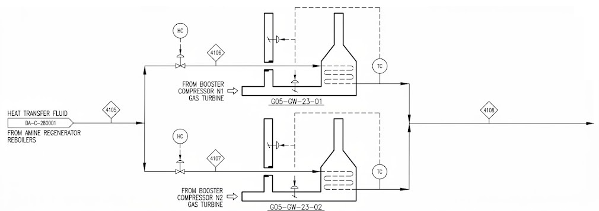
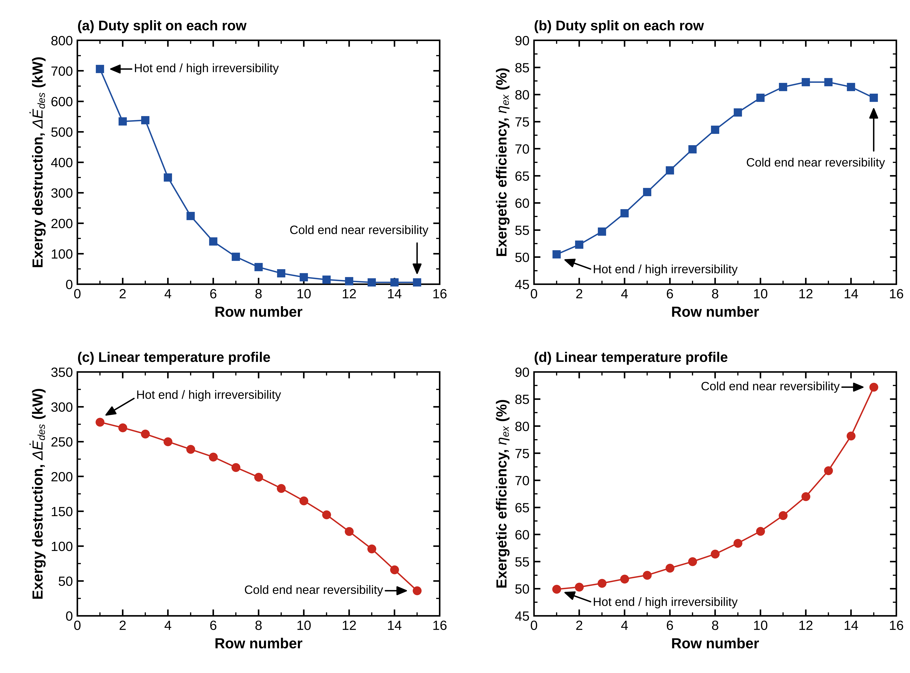
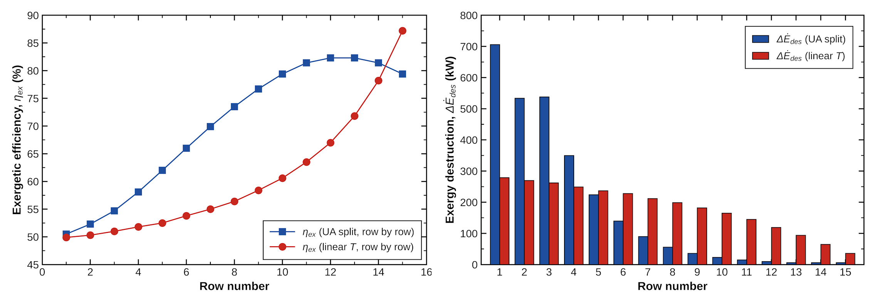

[English](README.md) | [Deutsch](README.de.md) | [Français](README.fr.md)

# Analyse exergétique des unités de récupération de chaleur fatale (WHRU) G05-GW-23-01 et 02 des turbines à gaz des compresseurs de gaz booster (Excel), Rhourde-Nouss

**Installation centrale de traitement du gaz naturel de Rhourde-Nouss, Sud-Est de l'Algérie**

  
   
  <em>Figure 1 : Unités de récupération de chaleur fatale G05-GW-23-01 et 02 des compresseurs de gaz booster, vue schématique (non à l'échelle).</em>

## Aperçu
Analyse exergétique d'une installation à deux unités de récupération de chaleur fatale (WHRU) récupérant la chaleur des gaz d'échappement des turbines des compresseurs de gaz booster dans une installation centrale de traitement (CPF) du gaz naturel.

Le rendement exergétique global d'une WHRU de turbine à gaz est calculé à partir des exergies du gaz et de l'huile, évaluées rangée par rangée sur les 16 rangées de l'unité. Deux configurations de profil de température sont comparées afin de montrer comment l'hypothèse de modélisation modifie la localisation et l'ampleur de la destruction d'exergie.

## Méthode
- Exergies du gaz et de l'huile calculées pour chacune des **16 rangées** de la WHRU.
- Deux configurations comparées :
  1. **Profil linéaire de température :** élévation linéaire de la température de l'huile et décroissance linéaire de la température des gaz d'échappement entre les entrées et les sorties de l'unité.
  2. **Répartition du UA :** UA, températures et pressions propres à chaque rangée.
- Destruction d'exergie (ΔĖdestruc) et rendement exergétique (ηex) évalués par rangée, ainsi que la part cumulée de la destruction d'exergie totale.

## Résultats clés
- **Rendement exergétique global :** ηex = 58,5 %, avec **2,75 MW** d'exergie détruite.
- **Distribution de la destruction d'exergie :**

| Configuration | Part de la destruction dans les 3 premières rangées | Part cumulée atteinte |
|---|---|---|
| Répartition du UA (UA propre à chaque rangée) | 65 % | 90 % à la rangée 6 |
| Profil linéaire de température | 29 % | 93 % à la rangée 12 |

## Pourquoi la répartition du UA est importante
Un profil linéaire de température entre les entrées et les sorties des deux flux impose un UA constant de **850 kW/°C** sur chaque rangée. Cela n'est pas physiquement possible, car le UA varie d'une rangée à l'autre à mesure que la chaleur est transférée entre les gaz d'échappement et l'huile caloporteuse circulant dans les tubes. La répartition du UA (décroissance du UA) tient compte de cette variation et montre que la destruction d'exergie est concentrée dans les premières rangées de l'unité, alors que le profil linéaire la répartit sur beaucoup plus de rangées.

## Figures

  
   
  <em>Figure 2 : Comparaison rangée par rangée des profils (température linéaire vs répartition du UA), du rendement exergétique (ηex) et de la destruction d'exergie (ΔĖdestruc).</em>

  
   
  <em>Figure 3 : Comparaison combinée rangée par rangée des profils (température linéaire vs répartition du UA), du rendement exergétique (ηex) et de la destruction d'exergie (ΔĖdestruc).</em>

Les graphiques OriginLab combinés montrent l'importance d'utiliser une répartition du UA (décroissance du UA) sur chaque rangée plutôt qu'un profil linéaire de température entre les entrées et les sorties des deux flux, qui impose un UA de 850 kW/°C à chaque rangée. Cela n'est pas physiquement possible, puisque le UA varie d'une rangée à l'autre lorsque la chaleur est transférée entre les gaz d'échappement et l'huile caloporteuse circulant dans les tubes.

## Outils
Microsoft Excel (calculs), OriginLab (graphiques)

## Compétences
Analyse exergétique - Rendement exergétique - Destruction d'exergie - Modélisation et analyse d'unités de récupération de chaleur fatale

## Remarques

Les données d'entrée ont été assainies ; aucune donnée confidentielle d'usine ou de fournisseur n'est incluse.

*Ce dépôt n'est qu'un aperçu de quelques résultats du modèle développé sous Excel (aucun classeur n'est joint).*
