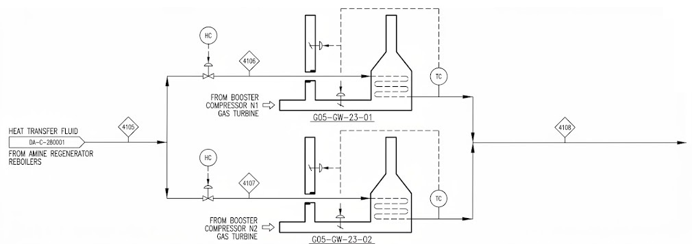
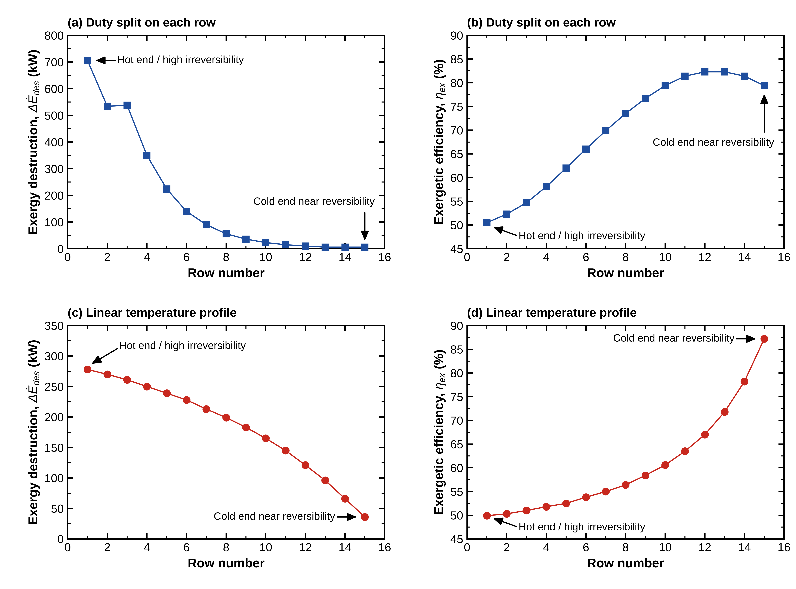
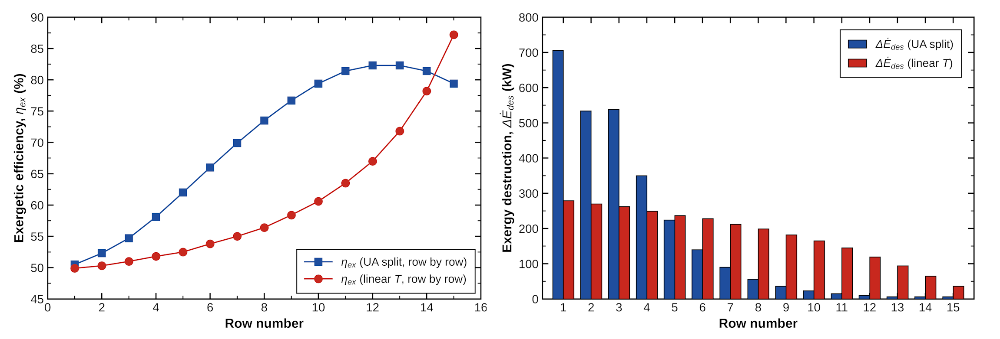

# Exergy Analysis of the G05-GW-23-01 and 02 Gas-Turbine Waste Heat Recovery Units (WHRU) from Booster Gas Compressors (Excel), Rhourde-Nouss

**Natural Gas Central Processing Facility, Southeastern Algeria**

  
   
  <em>Figure 1: G05-GW-23-01 and 02 Waste Heat Recovery Units from Booster Gas Compressors, schematic view (not to scale; no design values shown).</em>

## Overview
Exergy analysis of a double Waste Heat Recovery Unit (WHRU) installation recovering heat from the exhaust gases of the booster gas compressor turbines in a Central Processing Facility (CPF) for natural gas treatment.

The overall exergy efficiency of a gas-turbine WHRU is calculated from the gas and oil exergies evaluated row by row over the 16 rows of the unit. Two temperature profile configurations are compared to show how the modeling assumption changes the location and magnitude of the exergy destruction.

## Method
- Gas and oil exergies computed for each of the **16 rows** of the WHRU.
- Two configurations compared:
  1. **Linear temperature profile:** linear temperature rise of the oil and linear temperature decay of the exhaust gas between the unit inlets and outlets.
  2. **UA split:** row-specific UA, temperatures and pressures.
- Exergy destruction (ΔĖdestruc) and exergy efficiency (ηex) evaluated per row, together with the cumulative share of the total exergy destruction.

## Key Results
- **Overall exergy efficiency:** ηex = 58.5 %, with **2.75 MW** of exergy destroyed.
- **Distribution of the exergy destruction:**

| Configuration | Share of destruction in the first 3 rows | Cumulative share reached |
|---|---|---|
| UA split (row-specific UA) | 65 % | 90 % by row 6 |
| Linear temperature profile | 29 % | 93 % by row 12 |

## Why the UA Split Matters
A linear temperature profile between the inlets and outlets of both streams forces a constant UA of **850 kW/°C** on every row. This is not physically possible, because UA changes from row to row as heat is transferred between the exhaust gas and the heating oil flowing inside the tubes. The UA split decay accounts for this variation, and it shows that the exergy destruction is concentrated in the first rows of the unit, which the linear profile spreads out over many more rows.

## Figures

  
   
  <em>Figure 2: Row-by-Row Linear Temperature vs UA Split profiles, Exergy Efficiency (ηex) and Exergy Destruction (ΔĖdestruc) Comparison.</em>

  
   
  <em>Figure 3: Combined Row-by-Row Linear Temperature vs UA Split profiles, Exergy Efficiency (ηex) and Exergy Destruction (ΔĖdestruc) Comparison.</em>

The combined OriginLab plots show the importance of using a UA split decay over each row, rather than a linear temperature profile between the inlets and outlets for both streams, which forces a UA of 850 kW/°C on each row. This is physically not possible, since UA changes on each row when heat transfer takes place between the exhaust gas and the heating oil inside the tubes.

## Tools
Microsoft Excel (calculations), OriginLab (plots)

## Notes

Inputs are sanitized or normalized; no confidential plant or vendor data is included.

*This repository is only a preview of some results from the model developed in Excel (no workbook is attached).*
